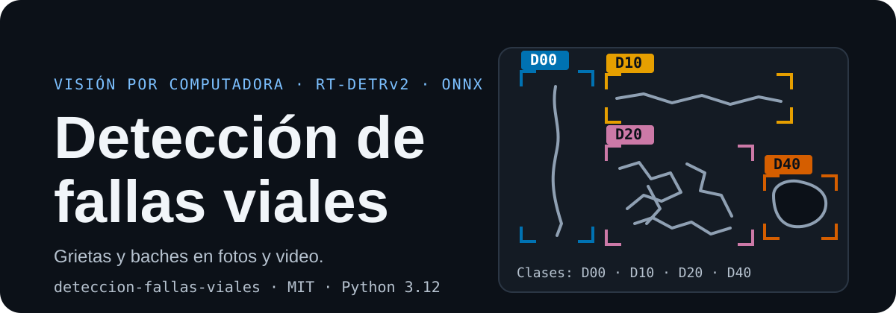
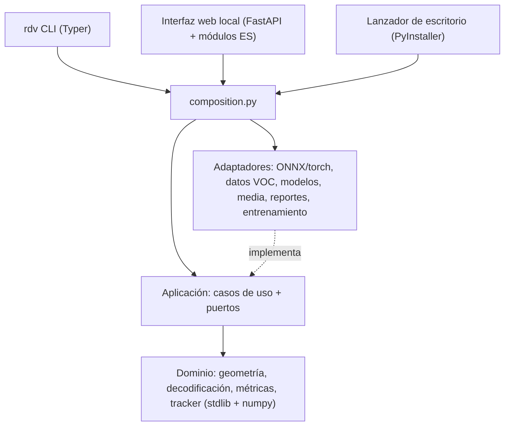

<p align="center"></p>

<p align="center"><b>Español</b> · <a href="README.en.md">English</a></p>

<p align="center"><b>Detecta grietas y baches en fotos y video de carretera con un modelo que corre en CPU, sin PyTorch, y una app web local.</b></p>

<p align="center">

[](https://github.com/Eduardo12Pacheco/deteccion-fallas-viales/actions/workflows/ci.yml) [](LICENSE) [](pyproject.toml) [](https://github.com/Eduardo12Pacheco/deteccion-fallas-viales/releases)

</p>

<p align="center"></p>

## Qué es

Detecta cuatro tipos de daño en el pavimento: grietas longitudinales (D00), grietas transversales (D10), piel de cocodrilo (D20) y baches (D40). Funciona sobre imágenes y video con un detector RT-DETRv2 exportado a ONNX, y se usa desde la CLI `rdv`, una app web local o un bundle de escritorio.

**Estado:** proyecto de portafolio en v0.1.0, con mantenimiento activo.

- **Imágenes y video:** PNG/JSON anotados por imagen más un MP4 con overlay, detecciones por frame, tracker IoU y resumen de cobertura de daño.
- **Aplicación local terminada:** FastAPI + módulos ES sin build, arrastrar y soltar, filtros de confianza/clase sin repetir la inferencia, descargas, modo claro/oscuro, teclado y móvil — capturas en [docs/assets/screenshots](docs/assets/screenshots).
- **Se instala en todas partes:** `uv tool install` en Linux, Windows y macOS, y bundles de escritorio PyInstaller desde GitHub Releases.

## Por qué es distinto

- **Detector con licencia clara:** RT-DETRv2 R18vd (código y pesos Apache-2.0) en lugar del stack AGPL-3.0 de Ultralytics; el rechazo está documentado en [ADR 0001](docs/adr/0001-detector-choice.md).
- **Fine-tune reproducible:** receta RT-DETRv2 con semillas sobre RDD2022 Japón/India/Chequia que cabe en una RTX 4060 de 8 GB (bf16, EMA, micro-batch automático, checkpoints reanudables) — ver [docs/TRAINING.md](docs/TRAINING.md).
- **Motor de métricas propio:** mAP COCO en numpy, curvas PR por clase, matriz de confusión 5x5, taxonomía de errores tipo TIDE, desglose por país y Noruega fuera de dominio, verificado contra `pycocotools` — ver [docs/EVALUATION.md](docs/EVALUATION.md).
- **Despliegue CPU primero:** un modelo ONNX de un solo archivo con instalación base sin torch; inferencia PyTorch/CUDA opcional dentro del entorno de entrenamiento.

## Cómo funciona



Arquitectura hexagonal de puertos y adaptadores con la dirección de dependencias verificada por `lint-imports` y un test AST; los patrones y el árbol de módulos están en [docs/ARCHITECTURE.md](docs/ARCHITECTURE.md).

## Inicio rápido

Requisitos: [uv](https://docs.astral.sh/uv/) (instala Python 3.12). Los mismos tres comandos funcionan en Linux, macOS y Windows (bash o PowerShell).

```bash
uv tool install https://github.com/Eduardo12Pacheco/deteccion-fallas-viales/releases/download/v0.1.0/road_damage_vision-0.1.0-py3-none-any.whl
rdv models pull
rdv serve
```

Comprueba la instalación con `rdv --version`, que responde `rdv 0.1.0`. Abre <http://127.0.0.1:16080>, suelta una imagen o un video y ajusta confianza/clases en vivo. Para un lote sin interfaz, sustituye el último comando por `rdv samples --dest samples && rdv detect samples/*.jpg --out detections` (el comodín `*` lo expande bash; en PowerShell lista los archivos explícitamente).

¿Sin Python? Descarga el bundle de tu plataforma desde [Releases](https://github.com/Eduardo12Pacheco/deteccion-fallas-viales/releases), descomprímelo y ejecuta `RoadDamageVision` (`RoadDamageVision.exe` en Windows). El modelo va incluido y la app funciona sin conexión.

| Plataforma | Archivo |
| --- | --- |
| Linux x64 | `RoadDamageVision-0.1.0-linux-x64.tar.gz` |
| Windows x64 | `RoadDamageVision-0.1.0-windows-x64.zip` |
| macOS arm64 | `RoadDamageVision-0.1.0-macos-arm64.tar.gz` |

Mientras el repositorio sea privado, autentícate con `gh auth login` y descarga los assets con `gh release download`; los mismos comandos funcionan con el wheel descargado.

## Resultados

Split de test retenido en dominio (Japón + India + Chequia), 2.100 imágenes, métricas COCO del motor propio; Noruega fuera de dominio nunca se usó para entrenar. Los números se generan desde `reports/v1` con `scripts/render_readme_metrics.py` y nunca se editan a mano.

<!-- metrics:start -->
| Metric | Value |
| --- | --- |
| mAP@0.5 | 0.3794 |
| mAP@0.5:0.95 | 0.1696 |
| AP@0.5 D00 | 0.3383 |
| AP@0.5 D10 | 0.3089 |
| AP@0.5 D20 | 0.4955 |
| AP@0.5 D40 | 0.3749 |
| CPU p50 (ms/image) | 156.3 |
| GPU p50 (ms/image) | 14.1 |
| OOD Norway mAP@0.5 | 0.0588 |
| OOD Norway mAP@0.5:0.95 | 0.0229 |
| S10 status | PASS (>= min bar) |
<!-- metrics:end -->

El mínimo S10 es mAP@0.5 >= 0,35, mAP@0.5:0.95 >= 0,15 y AP@0.5 >= 0,10 en cada clase. Reproduce con `rdv evaluate` (ver [docs/EVALUATION.md](docs/EVALUATION.md)); el registro completo está en [`reports/v1/run.json`](reports/v1/run.json) y la model card en [docs/MODEL_CARD.md](docs/MODEL_CARD.md).

## Limitaciones

- **No es seguridad crítica.** Los falsos negativos dominan el perfil de error; no uses la salida como única base para decisiones de mantenimiento, seguridad vial, seguros o legales.
- **El cambio de dominio es real:** Noruega da mAP@0.5 0,0588 y `D10` en India es casi cero en test; no extrapoles a cámaras o países no vistos.
- **Split propio, no el test oficial:** las anotaciones de test de RDD2022 nunca se publicaron, así que las métricas vienen de un split por bloques con semilla sobre las carpetas de entrenamiento etiquetadas; los bloques de ids consecutivos reducen pero no eliminan la fuga de fotogramas casi duplicados.
- **Puntajes poco confiados:** la cabeza v1 llega como máximo a 0,06 en los samples, por eso el umbral recomendado es 0,01 y no 0,25; el mAP reportado se basa en el ranking y no cambia.
- **Los conteos en video son aproximados:** el tracker IoU voraz no compensa el movimiento de la cámara, y la cobertura es descriptiva, no una puntuación PCI/severidad.
- **Bundles sin firmar:** Gatekeeper en macOS y SmartScreen en Windows avisan hasta que el usuario permita la app; el bundle de Linux requiere glibc 2.39+.
- **Duda de licencia:** el estatus legal de pesos entrenados con imágenes CC no está resuelto; la model card lo dice en lugar de afirmar una titularidad limpia.

## Documentación

| Documento | Contenido |
|---|---|
| [docs/ARCHITECTURE.md](docs/ARCHITECTURE.md) | Capas, puertos, adaptadores, patrones, diagramas y reglas de dependencia |
| [docs/DATA.md](docs/DATA.md) | Fuentes RDD2022, checksums, licencias, splits y fixtures |
| [docs/TRAINING.md](docs/TRAINING.md) | Entorno, configuración, corrida medida, reanudación y contrato de exportación |
| [docs/EVALUATION.md](docs/EVALUATION.md) | Semántica de métricas, umbral operativo, taxonomía y artefactos |
| [docs/MODEL_CARD.md](docs/MODEL_CARD.md) | Uso previsto, métricas, calibración, sesgos y notas éticas |
| [docs/RELEASING.md](docs/RELEASING.md) | Orden de release, assets, verificación y rollback |
| [docs/adr/](docs/adr/README.md) | Registros de decisiones de arquitectura 0001–0011 |
| [CONTRIBUTING.md](CONTRIBUTING.md) · [SECURITY.md](SECURITY.md) | Configuración de desarrollo y reporte de vulnerabilidades |
| [README.en.md](README.en.md) | Versión en inglés |

## Desarrollo

```bash
uv sync --extra train --extra cpu
make ci-local        # lint, tipos, tests, cobertura, docs y smoke de instalación limpia
```

Los tests son deterministas y offline por defecto (`pytest-socket`); la suite de navegador usa Playwright en localhost. Sin telemetría, sin claves de API y sin servicios en la nube.

## Licencias

- **Código:** MIT — ver [LICENSE](LICENSE).
- **Pesos base:** `PekingU/rtdetr_v2_r18vd`, Apache-2.0 (metadatos de Hugging Face).
- **Dataset:** RDD2022 (Figshare `21431547`), declarado CC BY 4.0; el paper y algunos mirrors dicen CC BY-SA 4.0, así que los fixtures y samples se redistribuyen con la postura conservadora CC BY-SA 4.0. Fuentes, checksums y linaje: [docs/DATA.md](docs/DATA.md).
- **Opción rechazada:** Ultralytics YOLO es AGPL-3.0 y no es dependencia; el inventario de terceros está en [THIRD_PARTY_LICENSES.md](THIRD_PARTY_LICENSES.md).

## Autor

Eduardo Pacheco · <https://github.com/Eduardo12Pacheco>
