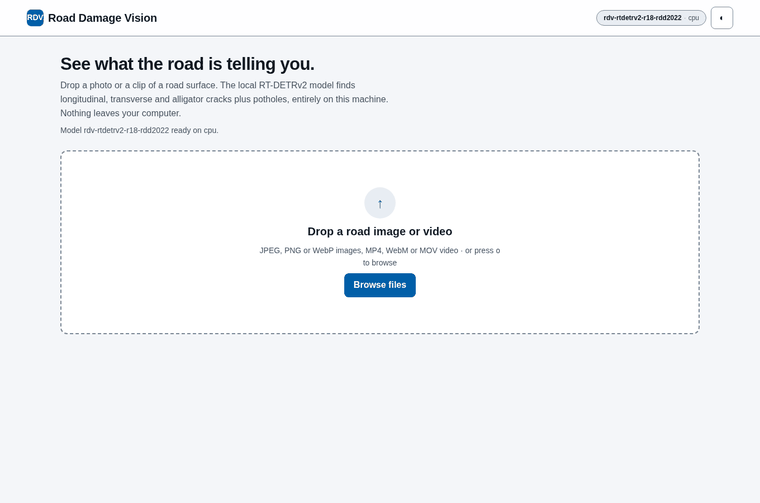
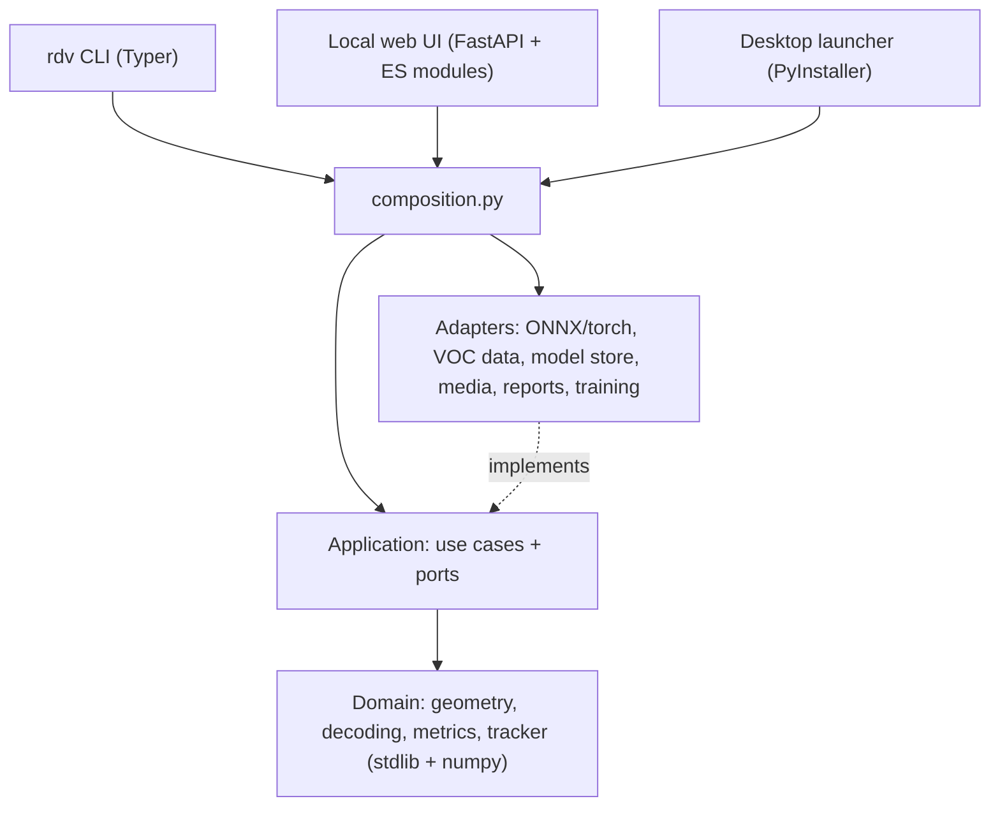

# deteccion-fallas-viales

Detect road damage — longitudinal, transverse and alligator cracks plus potholes — in images and video with a reproducible RT-DETRv2 fine-tune, a torch-free ONNX Runtime path and a finished local web app.

[](https://github.com/Eduardo12Pacheco/deteccion-fallas-viales/actions/workflows/ci.yml)
[](LICENSE)
[](pyproject.toml)
[](https://github.com/Eduardo12Pacheco/deteccion-fallas-viales/releases)



## What it does

- **License-aware detector:** RT-DETRv2 R18vd (Apache-2.0 code and weights) instead of the AGPL-3.0 Ultralytics stack; the rejection is documented in [ADR 0001](docs/adr/0001-detector-choice.md).
- **Reproducible fine-tune:** a seeded RT-DETRv2 recipe on RDD2022 Japan/India/Czech that fits an 8 GB RTX 4060 (bf16, EMA, auto micro-batch, resumable checkpoints) — see [docs/TRAINING.md](docs/TRAINING.md).
- **Own metrics engine:** numpy COCO mAP, per-class PR curves, 5x5 confusion matrix, TIDE-style error taxonomy, per-country and Norway OOD breakdowns, verified against `pycocotools` — see [docs/EVALUATION.md](docs/EVALUATION.md).
- **CPU-first deployment:** a single-file ONNX model with a sorted, torch-free base install; optional PyTorch/CUDA inference inside the training environment.
- **Images and video:** per-image annotated PNG/JSON plus an MP4 overlay, per-frame detections, an IoU tracker and a damage-coverage summary.
- **Finished local app:** FastAPI + vanilla ES modules, drag-and-drop, confidence/class filters without re-inference, downloads, light/dark, keyboard and mobile support — screenshots in [docs/assets/screenshots](docs/assets/screenshots).
- **Ships everywhere:** `uv tool install` on Linux/Windows/macOS (L1) and portable PyInstaller desktop bundles from GitHub Releases (L3).

## Architecture



Hexagonal ports and adapters with the dependency direction enforced by `lint-imports` and an AST test; patterns and module tree are documented in [docs/ARCHITECTURE.md](docs/ARCHITECTURE.md).

## Quickstart

Requirements: [uv](https://docs.astral.sh/uv/) (it provisions Python 3.12). The same three commands work on Linux, macOS and Windows (bash or PowerShell).

```bash
uv tool install https://github.com/Eduardo12Pacheco/deteccion-fallas-viales/releases/download/v0.1.0/road_damage_vision-0.1.0-py3-none-any.whl
rdv models pull
rdv serve
```

Open <http://127.0.0.1:16080>, drop an image or video, and adjust confidence/classes live. For a headless batch instead of the app, replace the last command with `rdv samples --dest samples && rdv detect samples/*.jpg --out detections`.

Prefer no Python? Download `RoadDamageVision-0.1.0-<platform>` from [Releases](https://github.com/Eduardo12Pacheco/deteccion-fallas-viales/releases), unpack it and run `RoadDamageVision`; the model is embedded and the app works offline. While the repository is private, authenticate with `gh auth login` and fetch assets with `gh release download`; the same commands then work with the downloaded wheel.

## Results

Held-out in-domain test split (Japan + India + Czech), 2,100 images, COCO metrics from the project's own engine; out-of-domain Norway was never trained on. Numbers are generated from `reports/v1` by `scripts/render_readme_metrics.py` and are never hand-edited.

<!-- metrics:start -->
| Metric | Value |
| --- | --- |
| mAP@0.5 | 0.3794 |
| mAP@0.5:0.95 | 0.1696 |
| AP@0.5 D00 | 0.3383 |
| AP@0.5 D10 | 0.3089 |
| AP@0.5 D20 | 0.4955 |
| AP@0.5 D40 | 0.3749 |
| CPU p50 (ms/image) | 156.3 |
| GPU p50 (ms/image) | 14.1 |
| OOD Norway mAP@0.5 | 0.0588 |
| OOD Norway mAP@0.5:0.95 | 0.0229 |
| S10 status | PASS (>= min bar) |
<!-- metrics:end -->

The S10 minimum bar is mAP@0.5 >= 0.35, mAP@0.5:0.95 >= 0.15 and every class AP@0.5 >= 0.10. Reproduce with `rdv evaluate` (see [docs/EVALUATION.md](docs/EVALUATION.md)); the full run record is in [`reports/v1/run.json`](reports/v1/run.json) and the model card in [docs/MODEL_CARD.md](docs/MODEL_CARD.md).

## Licenses

- **Code:** MIT — see [LICENSE](LICENSE).
- **Base weights:** `PekingU/rtdetr_v2_r18vd`, Apache-2.0 (Hugging Face metadata).
- **Dataset:** RDD2022 (Figshare `21431547`), declared CC BY 4.0; the paper/mirrors say CC BY-SA 4.0, so fixtures and samples are redistributed under the conservative CC BY-SA 4.0 stance. Sources, checksums and lineage: [docs/DATA.md](docs/DATA.md).
- **Rejected option:** Ultralytics YOLO is AGPL-3.0 and is not a dependency; the third-party inventory is in [THIRD_PARTY_LICENSES.md](THIRD_PARTY_LICENSES.md).

## Limitations

- **Not safety-critical.** Missed detections dominate the error profile; do not use the output as the only basis for maintenance, traffic-safety, insurance or legal decisions.
- **Domain shift is real:** Norway mAP@0.5 is 0.0588 and Indian `D10` is nearly zero on the test split; do not extrapolate to unseen cameras or countries.
- **Own split, not the official test set:** RDD2022 test annotations were never released, so metrics come from a seeded block split of the labeled train folders; consecutive-id blocks reduce but do not eliminate near-duplicate leakage.
- **Under-confident scores:** the v1 head tops out near 0.06 on the samples, so the recommended threshold is 0.01 rather than 0.25; the reported mAP is ranking-based and unaffected.
- **Video counts are approximate:** the greedy IoU tracker has no ego-motion compensation, and the coverage ratio is descriptive, not a PCI/severity score.
- **Unsigned desktop builds:** macOS Gatekeeper and Windows SmartScreen warn until the user allows the app; the Linux bundle needs glibc 2.39+.
- **License question:** the legal status of weights trained on CC-licensed images is unsettled; the model card states this rather than claiming clean title.

## Documentation

| Document | Contents |
|---|---|
| [docs/ARCHITECTURE.md](docs/ARCHITECTURE.md) | Layers, ports, adapters, patterns, diagrams and dependency rules |
| [docs/DATA.md](docs/DATA.md) | RDD2022 sources, checksums, licenses, splits and fixtures |
| [docs/TRAINING.md](docs/TRAINING.md) | Environment, config, measured run, resume and export contract |
| [docs/EVALUATION.md](docs/EVALUATION.md) | Metric semantics, operating threshold, taxonomy and artifacts |
| [docs/MODEL_CARD.md](docs/MODEL_CARD.md) | Intended use, metrics, calibration, biases and ethical notes |
| [docs/RELEASING.md](docs/RELEASING.md) | Release order, assets, verification and rollback |
| [docs/adr/](docs/adr/README.md) | Architecture decision records 0001–0011 |
| [CONTRIBUTING.md](CONTRIBUTING.md) · [SECURITY.md](SECURITY.md) | Development setup and vulnerability reporting |
| [README.es.md](README.es.md) | Versión en español |

## Development

```bash
uv sync --extra train --extra cpu
make ci-local        # lint, types, tests, coverage, docs and clean-install smoke
```

Tests are deterministic and offline by default (`pytest-socket`); the browser suite uses Playwright on localhost. No telemetry, no API keys, no cloud services.
