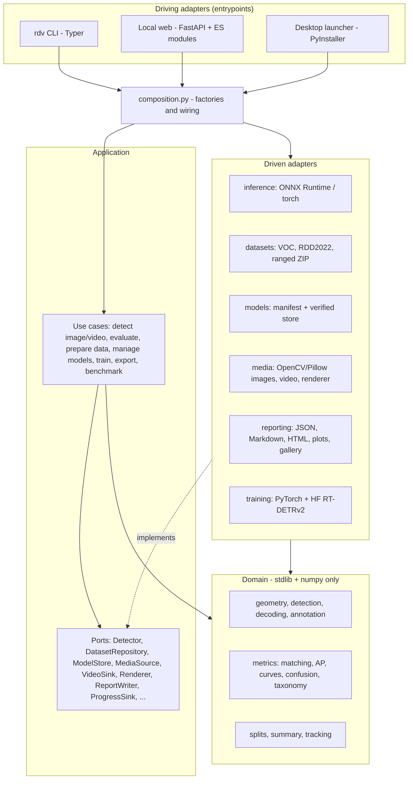

# Architecture

`road-damage-vision` is a local-first Python 3.12 application built as a
hexagonal (ports and adapters) system. The domain is pure pixel/box/track
maths, application use cases orchestrate ports, adapters own every library or
I/O dependency, and entrypoints only translate user input into use cases.

The dependency direction is enforced mechanically, not by convention: an
import-linter contract plus an AST test fail CI if a layer imports upwards or if
the domain/application layers touch OpenCV, Pillow, ONNX Runtime, torch,
FastAPI, httpx, Typer, matplotlib, YAML or SciPy (ADR 0003).

## Layers



| Layer | May import | Responsibility |
|---|---|---|
| `rdv.domain` | stdlib, numpy | Value objects, IoU, decoding, splits, tracker, metrics. No I/O, no clock, no randomness except seeded helpers. |
| `rdv.application` | domain, stdlib, numpy | Use cases and `typing.Protocol` ports. No third-party I/O libraries. |
| `rdv.adapters` | application, domain, any third-party library | Concrete implementations. Adapter subpackages must not import each other. |
| `rdv.composition` | adapters, application, domain, config | Builds adapters from `Settings`; the only place that knows concrete classes. |
| `rdv.entrypoints` | composition, application, config, domain | Typer CLI, FastAPI app, desktop launcher. |
| `rdv.config`, `rdv.errors`, `rdv.hashing` | stdlib, pydantic | Cross-cutting settings, error hierarchy and hashing helpers. |

## Module tree

```
src/rdv/
├── composition.py          # factories: detector, store, repositories, report writers
├── config/{settings,logging}.py
├── errors.py  hashing.py
├── domain/
│   ├── classes.py  geometry.py  detection.py  annotation.py  decoding.py
│   ├── splits.py  summary.py  tracking.py
│   └── metrics/{matching,average_precision,curves,confusion,error_analysis,evaluator}.py
├── application/
│   ├── ports.py  events.py  pipeline.py
│   ├── detect_image.py  detect_video.py  evaluate_model.py  prepare_dataset.py
│   ├── manage_models.py  train_model.py  export_model.py  benchmark.py
├── adapters/
│   ├── inference/{preprocess,providers,onnx_detector,torch_detector}.py
│   ├── datasets/{voc,rdd2022,remote_zip}.py
│   ├── models/{manifest,store}.py
│   ├── media/{images,video,renderer}.py
│   ├── reporting/{detections_json,summary_md,eval_report,plots,gallery,html}.py
│   └── training/{config,dataset,augment,ema,autobatch,trainer,export_onnx}.py
├── entrypoints/
│   ├── cli/{app,console,detect,evaluate,train,export,data,models,serve,benchmark,doctor,samples}.py
│   ├── web/{app,api,jobs,security,report}.py  web/static/...
│   └── desktop.py
└── assets/{models.json,samples/,schemas/}
```

## Ports

Ports are `typing.Protocol` classes in `rdv/application/ports.py`; adapters are
selected in `composition.py`.

| Port | Contract | Adapters |
|---|---|---|
| `Detector` | `detect(images) -> list[list[Detection]]`, `info -> ModelInfo` | `OnnxDetector`, `TorchDetector`, test fakes |
| `DatasetRepository` | metadata iteration by split/country, lazy `load_image`, `stats` | `Rdd2022VocRepository`, `VocDirectoryRepository` |
| `ModelStore` | resolve/pull/verify pinned model files | `CachedModelStore` |
| `MediaSource` / `VideoSource` | decode a still image / stream frames with fps and rotation | `PillowImageSource`, `OpenCvVideoSource` |
| `VideoSink` | write an annotated video atomically | `OpenCvVideoSink` |
| `Renderer` | draw boxes and labels on a frame | `PillowRenderer` |
| `DetectionsWriter` / `SummaryWriter` | persist detections and aggregate summaries | JSON / Markdown writers |
| `EvaluationReportWriter` | write metrics, plots, gallery and HTML | `EvaluationReportAdapter` |
| `ProgressSink` | observe progress events | Rich progress, web job state, `NullProgressSink` |
| `Trainer` (training adapter) | fit, checkpoint, resume, export | `RtDetrTrainer` |

## Use cases

| Use case | Entrypoint | Main collaborators |
|---|---|---|
| `detect_images` | `rdv detect IMG...` | `Detector`, `MediaSource`, `Renderer`, writers |
| `detect_video` | `rdv detect VIDEO` | `VideoSource`, `Detector`, `IouTracker`, `VideoSink`, writers |
| `evaluate_model` | `rdv evaluate` | `DatasetRepository`, `Detector`, metrics engine, report writer |
| `prepare_dataset` | `rdv data` | `ArchiveSource`, VOC parser, split module |
| `manage_models` | `rdv models` | `ModelStore`, manifest |
| `train_model` / `export_model` | `rdv train`, `rdv export` | `Trainer`, typed config, exporter |
| `benchmark` | `rdv benchmark` | `Detector`, synthetic frames, hardware probe |

Use cases return value objects or write artifacts; they never print. The CLI
console and the web job manager are the presentation layer.

## Patterns used deliberately

- **Ports and adapters (hexagonal).** The domain and application never import
  the frameworks; swapping ONNX for torch is a composition change.
- **Repository.** `Rdd2022VocRepository` and `VocDirectoryRepository` hide the
  filesystem layout and expose lazy, deterministic image iteration.
- **Strategy.** Execution-provider selection (`auto|cpu|cuda`), score-threshold
  precedence and the `onnx|torch` backend are small interchangeable policies.
- **Factory + composition root.** `composition.py` builds every adapter from
  `Settings`; import-time side effects are avoided so importing the CLI stays
  torch-free (S2).
- **Pipeline / chain of stages.** Video analysis is `FrameSource ->
  StrideSelector -> DetectStage -> TrackStage -> Sinks`, with typed
  `FramePacket`s and an early-end guard.
- **Observer.** `ProgressSink` receives immutable progress events; the CLI, the
  web job registry and tests are independent observers.
- **Value objects.** Frozen, validated `BBox`, `Detection`, `FrameResult`,
  `AnnotatedImage` and `ProgressEvent` prevent invalid state at the boundary.
- **Template method for reports.** Markdown and HTML reports share one
  view-model, so every section renders from the same numbers.
- **Command objects.** One module per CLI command group converts options into a
  use-case call and maps `RdvError.exit_code` to the process exit code.
- **Null Object.** `NullProgressSink` keeps `--quiet`/library callers free of
  conditionals.

There is no database, no unit-of-work abstraction and no generic repository
layer: those would add indirection without a second implementation.

## Configuration, logging and errors

- `rdv.config.settings.Settings` is a typed pydantic-settings model with the
  `RDV_` prefix (for example `RDV_MODEL_DIR`, `RDV_PORT` default `16080`,
  `RDV_DEVICE`, `RDV_OFFLINE`). Invalid values raise `ConfigError` (exit 6).
- `rdv.config.logging.configure_logging` emits colourless console logs or
  one-object-per-line JSON with `event`, `level` and an ISO-8601 UTC timestamp.
  No module prints; the CLI console owns user-facing output.
- `rdv.errors` defines `RdvError(exit_code)` and the hierarchy `DatasetError=3`,
  `ModelError=4`, `MediaError=5`, `ConfigError`/`MissingExtraError=6`; usage
  errors are 2 and unexpected failures 1.

## Optional heavy dependencies

- The base install has no torch/transformers/scipy; only `rdv.adapters.training`
  may import that stack statically, and `TorchDetector` loads it through
  `importlib` to respect the contract while staying in `adapters.inference`.
- Matplotlib and Jinja2 live only in `adapters.reporting` and are imported
  lazily by composition, so the desktop bundle never loads the plotting stack.
- OpenCV is optional in the desktop bundle: image preprocessing has a NumPy
  fallback and video uploads return a clear error there (ADR 0007).

## Concurrency and resources

- The web app owns one worker thread and a queue; analyses are polled, not
  streamed. Uploads live in a per-process temp directory removed by TTL and at
  shutdown (ADR 0006).
- ONNX Runtime uses the physical core count for `intra_op_num_threads`.
  Inference is CPU-first; CUDA is optional.
- Video and report outputs are written to a `.part` name and atomically renamed
  only after a complete stream, so a crash never leaves a misleading final file.
- `RDV_OFFLINE=1` makes every network attempt fail before the first request;
  only `rdv models pull` and `rdv data download` download anything, and both
  verify pinned digests.

## Testing the architecture

| Test | Guarantee |
|---|---|
| `tests/unit/test_architecture.py` | `lint-imports` keeps the four contracts; AST scan rejects forbidden imports in `domain`/`application` |
| `tests/unit/test_no_network_policy.py` | `pytest-socket` blocks external sockets in the default run |
| `tests/unit/test_license_guard.py` | No AGPL/GPL runtime dependency |
| `tests/unit/domain/**` | Pure domain logic, property-based invariants |
| `tests/integration/**` | Adapters on committed fixtures, no network |
| `tests/e2e/**` | CLI subprocess and web `TestClient` flows |
| `tests/e2e/ui/**` (`-m ui`) | Real browser on a localhost 16000-16999 port |

## Adding a feature

1. Put pure logic in `rdv.domain` with a unit/property test.
2. Declare or extend a `Protocol` in `rdv.application.ports` and write the use
   case against ports only.
3. Implement the adapter under `rdv.adapters.<area>`; keep adapters independent.
4. Wire it in `composition.py` and expose it through an entrypoint.
5. Run `uv run lint-imports`, `uv run mypy --strict src` and the full suite; add
   an ADR if the change alters a documented decision.

See [ADR 0003](adr/0003-hexagonal-architecture.md) for the enforcement details,
[ADR 0004](adr/0004-torch-free-base-onnx-runtime.md) for the dependency split and
[ADR 0006](adr/0006-local-web-ui.md) / [ADR 0007](adr/0007-desktop-bundles.md) for
the serving paths.
