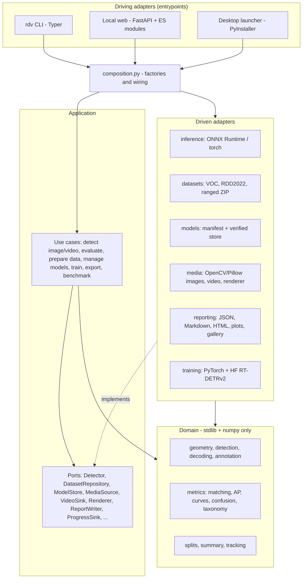

# Arquitectura

`road-damage-vision` es una aplicación local en Python 3.12 construida como un sistema
hexagonal (puertos y adaptadores). El dominio contiene solo matemática pura de píxeles, cajas
y tracks; los casos de uso de la aplicación orquestan puertos; los adaptadores son dueños de
cada dependencia de biblioteca o de E/S; y los entrypoints solo traducen la entrada del usuario
en casos de uso.

La dirección de las dependencias se verifica de forma mecánica, no por convención: un contrato
de import-linter y un test AST hacen fallar la CI si una capa importa hacia arriba o si las
capas de dominio y aplicación tocan OpenCV, Pillow, ONNX Runtime, torch, FastAPI, httpx, Typer,
matplotlib, YAML o SciPy (ADR 0003).

## Capas



| Capa | Puede importar | Responsabilidad |
|---|---|---|
| `rdv.domain` | biblioteca estándar, numpy | Objetos de valor, IoU, decodificación, splits, tracker, métricas. Sin E/S, sin reloj, sin aleatoriedad salvo auxiliares con semilla. |
| `rdv.application` | domain, biblioteca estándar, numpy | Casos de uso y puertos `typing.Protocol`. Sin bibliotecas de E/S de terceros. |
| `rdv.adapters` | application, domain, cualquier biblioteca de terceros | Implementaciones concretas. Los subpaquetes de adaptadores no deben importarse entre sí. |
| `rdv.composition` | adapters, application, domain, config | Construye los adaptadores a partir de `Settings`; es el único lugar que conoce las clases concretas. |
| `rdv.entrypoints` | composition, application, config, domain | CLI con Typer, aplicación FastAPI, lanzador de escritorio. |
| `rdv.config`, `rdv.errors`, `rdv.hashing` | biblioteca estándar, pydantic | Ajustes transversales, jerarquía de errores y auxiliares de hash. |

## Árbol de módulos

```
src/rdv/
├── composition.py          # factories: detector, store, repositories, report writers
├── config/{settings,logging}.py
├── errors.py  hashing.py
├── domain/
│   ├── classes.py  geometry.py  detection.py  annotation.py  decoding.py
│   ├── splits.py  summary.py  tracking.py
│   └── metrics/{matching,average_precision,curves,confusion,error_analysis,evaluator}.py
├── application/
│   ├── ports.py  events.py  pipeline.py
│   ├── detect_image.py  detect_video.py  evaluate_model.py  prepare_dataset.py
│   ├── manage_models.py  train_model.py  export_model.py  benchmark.py
├── adapters/
│   ├── inference/{preprocess,providers,onnx_detector,torch_detector}.py
│   ├── datasets/{voc,rdd2022,remote_zip}.py
│   ├── models/{manifest,store}.py
│   ├── media/{images,video,renderer}.py
│   ├── reporting/{detections_json,summary_md,eval_report,plots,gallery,html}.py
│   └── training/{config,dataset,augment,ema,autobatch,trainer,export_onnx}.py
├── entrypoints/
│   ├── cli/{app,console,detect,evaluate,train,export,data,models,serve,benchmark,doctor,samples}.py
│   ├── web/{app,api,jobs,security,report}.py  web/static/...
│   └── desktop.py
└── assets/{models.json,samples/,schemas/}
```

## Puertos

Los puertos son clases `typing.Protocol` en `rdv/application/ports.py`; los adaptadores se
seleccionan en `composition.py`.

| Puerto | Contrato | Adaptadores |
|---|---|---|
| `Detector` | `detect(images) -> list[list[Detection]]`, `info -> ModelInfo` | `OnnxDetector`, `TorchDetector`, fakes de test |
| `DatasetRepository` | iteración de metadatos por split/país, `load_image` perezoso, `stats` | `Rdd2022VocRepository`, `VocDirectoryRepository` |
| `ModelStore` | resolver/descargar/verificar archivos de modelo fijados | `CachedModelStore` |
| `MediaSource` / `VideoSource` | decodificar una imagen fija / transmitir fotogramas con fps y rotación | `PillowImageSource`, `OpenCvVideoSource` |
| `VideoSink` | escribir un video anotado de forma atómica | `OpenCvVideoSink` |
| `Renderer` | dibujar cajas y etiquetas sobre un fotograma | `PillowRenderer` |
| `DetectionsWriter` / `SummaryWriter` | persistir detecciones y resúmenes agregados | escritores JSON / Markdown |
| `EvaluationReportWriter` | escribir métricas, gráficos, galería y HTML | `EvaluationReportAdapter` |
| `ProgressSink` | observar eventos de progreso | progreso de Rich, estado de trabajos web, `NullProgressSink` |
| `Trainer` (adaptador de entrenamiento) | ajustar, guardar checkpoints, reanudar, exportar | `RtDetrTrainer` |

## Casos de uso

| Caso de uso | Entrypoint | Colaboradores principales |
|---|---|---|
| `detect_images` | `rdv detect IMG...` | `Detector`, `MediaSource`, `Renderer`, escritores |
| `detect_video` | `rdv detect VIDEO` | `VideoSource`, `Detector`, `IouTracker`, `VideoSink`, escritores |
| `evaluate_model` | `rdv evaluate` | `DatasetRepository`, `Detector`, motor de métricas, escritor de informes |
| `prepare_dataset` | `rdv data` | `ArchiveSource`, parser VOC, módulo de splits |
| `manage_models` | `rdv models` | `ModelStore`, manifiesto |
| `train_model` / `export_model` | `rdv train`, `rdv export` | `Trainer`, configuración tipada, exportador |
| `benchmark` | `rdv benchmark` | `Detector`, fotogramas sintéticos, sonda de hardware |

Los casos de uso devuelven objetos de valor o escriben artefactos; nunca imprimen. La consola de
la CLI y el gestor de trabajos web son la capa de presentación.

## Patrones usados deliberadamente

- **Puertos y adaptadores (hexagonal).** El dominio y la aplicación nunca importan los frameworks;
  cambiar ONNX por torch es un cambio de composición.
- **Repositorio.** `Rdd2022VocRepository` y `VocDirectoryRepository` ocultan la estructura de
  archivos y exponen una iteración de imágenes perezosa y determinista.
- **Strategy.** La selección del proveedor de ejecución (`auto|cpu|cuda`), la precedencia del
  umbral de puntaje y el backend `onnx|torch` son políticas pequeñas e intercambiables.
- **Factory + raíz de composición.** `composition.py` construye cada adaptador a partir de
  `Settings`; se evitan los efectos secundarios al importar para que importar la CLI no cargue
  torch (S2).
- **Pipeline / cadena de etapas.** El análisis de video es `FrameSource ->
  StrideSelector -> DetectStage -> TrackStage -> Sinks`, con `FramePacket` tipados y una
  guarda de fin anticipado.
- **Observer.** `ProgressSink` recibe eventos de progreso inmutables; la CLI, el registro de
  trabajos web y los tests son observadores independientes.
- **Objetos de valor.** `BBox`, `Detection`, `FrameResult`, `AnnotatedImage` y `ProgressEvent`
  son inmutables y validados, lo que impide estados inválidos en la frontera.
- **Método plantilla para informes.** Los informes Markdown y HTML comparten un mismo modelo de
  vista, de modo que cada sección se renderiza con los mismos números.
- **Objetos de comando.** Un módulo por grupo de comandos de la CLI convierte las opciones en una
  llamada a un caso de uso y asigna `RdvError.exit_code` al código de salida del proceso.
- **Null Object.** `NullProgressSink` evita condicionales en `--quiet` y en los llamadores de la
  biblioteca.

No hay base de datos, ni abstracción de unidad de trabajo, ni capa de repositorio genérica: eso
añadiría indirección sin una segunda implementación.

## Configuración, logging y errores

- `rdv.config.settings.Settings` es un modelo pydantic-settings tipado con el prefijo `RDV_` (por
  ejemplo `RDV_MODEL_DIR`, `RDV_PORT` con valor por defecto `16080`, `RDV_DEVICE`, `RDV_OFFLINE`).
  Los valores inválidos lanzan `ConfigError` (código de salida 6).
- `rdv.config.logging.configure_logging` emite logs de consola sin color o un objeto JSON por línea
  con `event`, `level` y una marca de tiempo UTC ISO-8601. Ningún módulo imprime; la consola de la
  CLI es la dueña de la salida hacia el usuario.
- `rdv.errors` define `RdvError(exit_code)` y la jerarquía `DatasetError=3`, `ModelError=4`,
  `MediaError=5`, `ConfigError`/`MissingExtraError=6`; los errores de uso son 2 y los fallos
  inesperados 1.

## Dependencias pesadas opcionales

- La instalación base no incluye torch/transformers/scipy; solo `rdv.adapters.training` puede
  importar ese stack de forma estática, y `TorchDetector` lo carga mediante `importlib` para respetar
  el contrato y permanecer en `adapters.inference`.
- Matplotlib y Jinja2 viven solo en `adapters.reporting` y composition los importa de forma perezosa,
  así que el bundle de escritorio nunca carga el stack de gráficos.
- OpenCV es opcional en el bundle de escritorio: el preprocesamiento de imágenes tiene un respaldo en
  NumPy y las cargas de video devuelven un error claro allí (ADR 0007).

## Concurrencia y recursos

- La aplicación web tiene un hilo worker y una cola; los análisis se sondean, no se transmiten. Las
  cargas viven en un directorio temporal por proceso que se elimina por TTL y al apagar (ADR 0006).
- ONNX Runtime usa el número de núcleos físicos para `intra_op_num_threads`. La inferencia es
  primero CPU; CUDA es opcional.
- Las salidas de video e informes se escriben con un nombre `.part` y solo se renombran de forma
  atómica tras un flujo completo, de modo que un fallo nunca deje un archivo final engañoso.
- `RDV_OFFLINE=1` hace que cada intento de red falle antes de la primera petición; solo `rdv models
  pull` y `rdv data download` descargan algo, y ambos verifican los digests fijados.

## Pruebas de la arquitectura

| Test | Garantía |
|---|---|
| `tests/unit/test_architecture.py` | `lint-imports` mantiene los cuatro contratos; un escaneo AST rechaza imports prohibidos en `domain`/`application` |
| `tests/unit/test_no_network_policy.py` | `pytest-socket` bloquea sockets externos en la ejecución por defecto |
| `tests/unit/test_license_guard.py` | Ninguna dependencia de runtime AGPL/GPL |
| `tests/unit/domain/**` | Lógica de dominio pura, invariantes basadas en propiedades |
| `tests/integration/**` | Adaptadores sobre fixtures versionados, sin red |
| `tests/e2e/**` | Subprocesos de la CLI y flujos de `TestClient` de la web |
| `tests/e2e/ui/**` (`-m ui`) | Navegador real en un puerto localhost 16000-16999 |

## Agregar una funcionalidad

1. Pon la lógica pura en `rdv.domain` con un test unitario o de propiedades.
2. Declara o extiende un `Protocol` en `rdv.application.ports` y escribe el caso de uso solo contra
   puertos.
3. Implementa el adaptador en `rdv.adapters.<area>`; mantén los adaptadores independientes.
4. Conéctalo en `composition.py` y exponlo mediante un entrypoint.
5. Ejecuta `uv run lint-imports`, `uv run mypy --strict src` y la suite completa; agrega un ADR si el
   cambio altera una decisión documentada.

Consulta el [ADR 0003](adr/0003-hexagonal-architecture.md) para los detalles de la aplicación de
reglas, el [ADR 0004](adr/0004-torch-free-base-onnx-runtime.md) para la separación de dependencias y
el [ADR 0006](adr/0006-local-web-ui.md) / [ADR 0007](adr/0007-desktop-bundles.md) para las rutas de
servicio.
